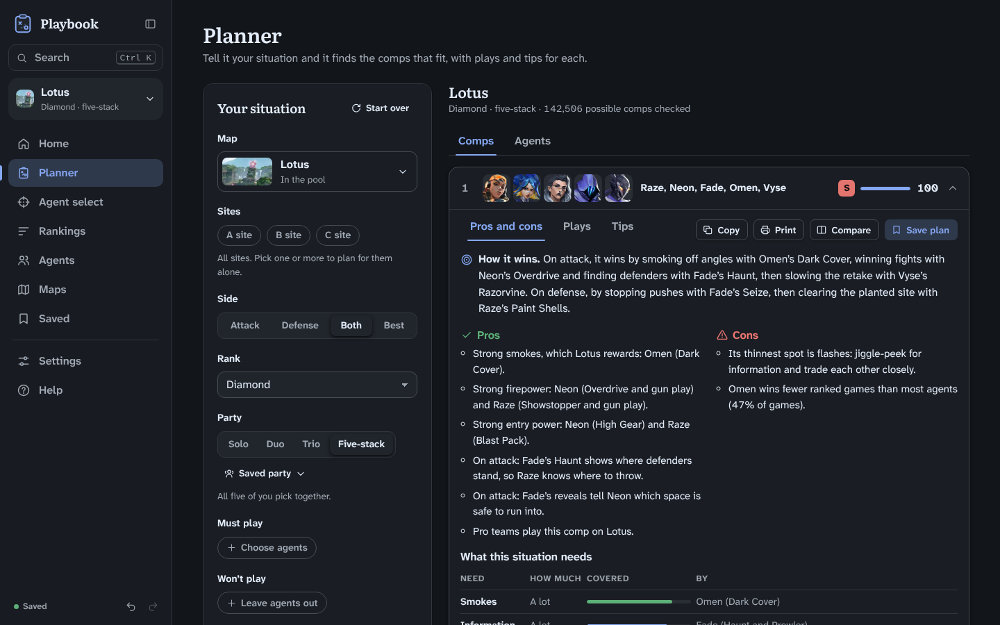
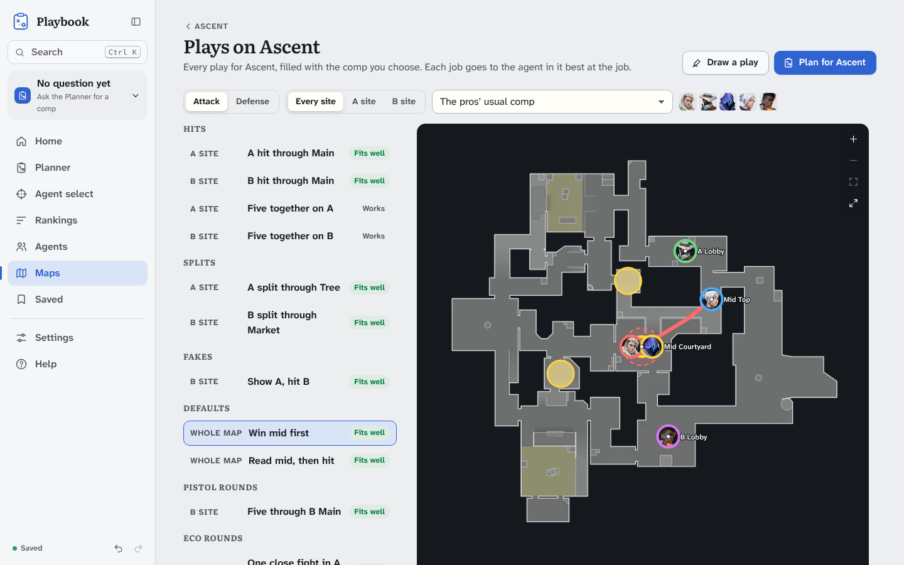
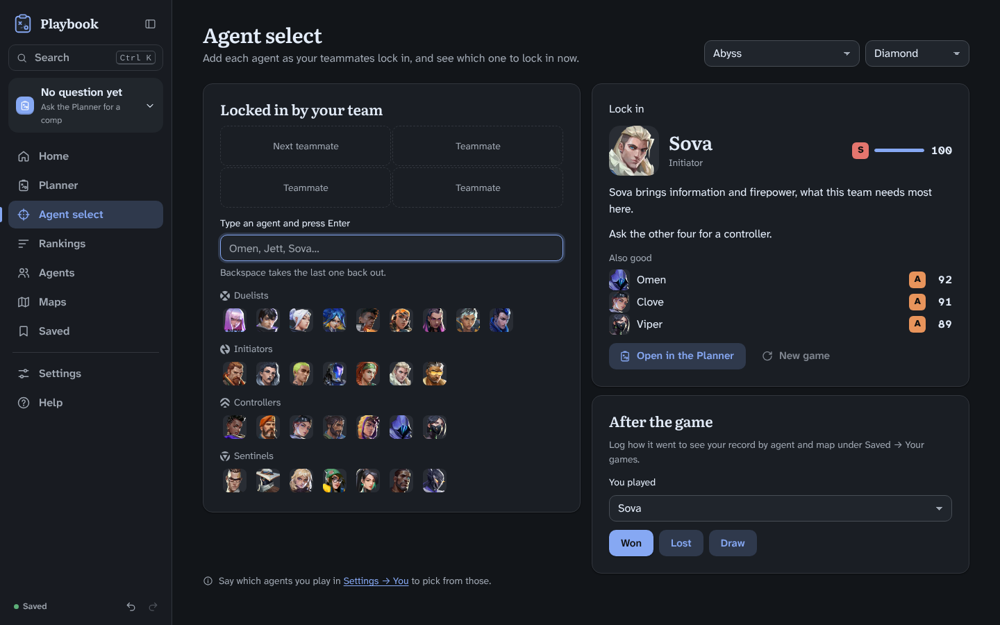
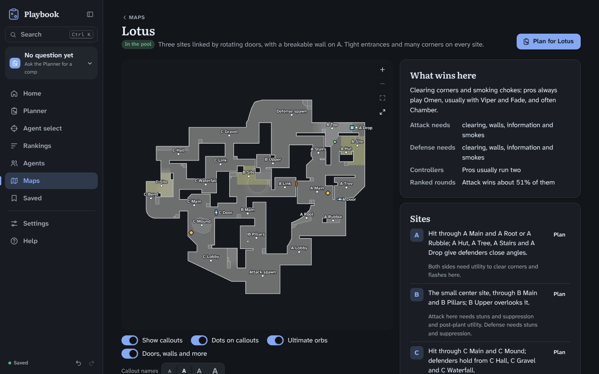
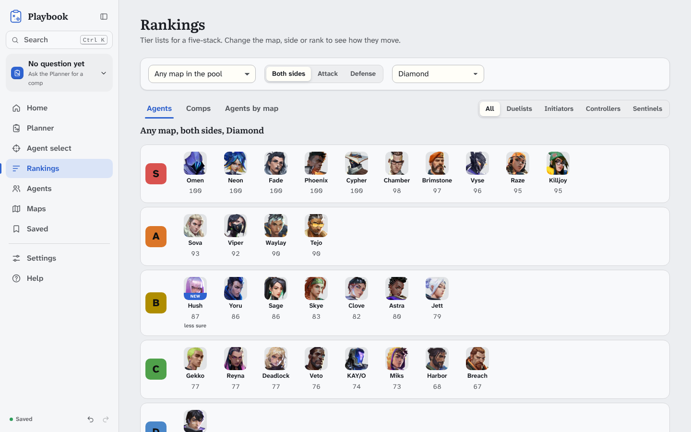

# Playbook

Playbook is an offline team comp planner for VALORANT. Give it the map, your side, your rank and who you're queuing with, and it ranks the comps and agents that fit. Each comp comes with how it wins, its pros and cons, and plays you can run on the minimap.

**[Download the latest version](https://github.com/unbrokensovereignty/playbook/releases/latest)**

It's free and it's a single HTML file. There's nothing to install, no account to make, and it works offline.



## Getting started

1. Download `Playbook-v0.5.5.html` from the [latest release](https://github.com/unbrokensovereignty/playbook/releases/latest). There's also a copy in the root of this repository.
2. Open it in Chrome, Edge, Firefox or Safari on a computer. Double-clicking the file works.
3. Pick your rank, how you usually queue and the agents you play. It takes a few seconds, and every plan starts from there.
4. Go to the Planner and ask. Anything you leave blank, Playbook works out for you.

That file is the whole app. Put it wherever you like. It never goes online and doesn't need anything else to run. For a quick walkthrough of any page, open Help → Tours.

## What you can do with it

### Plan a comp

Fill in as much or as little as you know. That can be the map, your side and which sites you'll play, your rank (Iron to Radiant), and whether you're solo, in a duo, a trio or a five-stack. You can also list agents you have to play or won't play, teammates who've already locked in, the enemy team's agents if you know them, and how many of each role you want.

It works the other way round too. Give it a comp and ask for its best map, side or rank. A five-stack asking for its best map also gets a list of maps to play and maps to ban, with the reasons.

Every comp gets a fit score out of 100 and a tier from S to D. Open one to see how it wins, its pros and cons in your situation, how it stacks up against what pro teams run, and the plays it can run, with each player's job shown on the minimap. You can copy a plan into team chat or print it on one page.

### Get advice for your rank

Playbook looks at what a team at your rank actually gets out of each agent. It weighs ranked win rates (Radiant's own near the top) and, mostly from Diamond up, what pro teams pick. The agents players at your rank lock in most tell it what your random teammates are likely to play. Agents that are hard to get value from, and plays that need a lot of coordination, count for less at lower ranks.

### Run plays on every map



There are hits, splits, fakes, defaults, setups, stacks, pushes and retakes for every site on all 13 maps, plus pistol, eco and anti-eco rounds. Each play is filled in with your comp and replays on a minimap you can zoom and drag, with smokes, walls and flashes landing where they should. You can also draw your own plays step by step, and the Planner will fill them in with any comp alongside the built-in ones.

### Pick your agent



Agent select is for the last few seconds before you lock in. Add agents as your teammates pick them and Playbook tells you who to lock and why. After the game you can log the result and track your record by agent and map.

### Browse rankings, agents and maps



The Rankings page has agent and comp tier lists for any map, side and rank, plus a table of every agent on every map. Each agent has a page with their kit, strengths, best maps and best partners. Each map has a page with its sites, callouts and best comps, on a minimap that can also show ult orbs, doors, walls, teleporters and ziplines.



### Save things and make it yours

You can save plans with a note, save your usual party along with the agents each of you plays, and keep the plays you draw and the games you log. There are light and dark themes (or make your own), plus settings for text size, motion and sound. Everything works from the keyboard, and every change can be undone.

## Where the numbers come from

Everything Playbook knows is built into the file.

| What | Source |
| --- | --- |
| Agents, abilities, maps, callouts and art | The game's own content |
| Ranked pick and win rates, across all ranks and on each map | [metabot.gg](https://www.metabot.gg) and [winio.ai](https://winio.ai) |
| The agents picked most at each rank, and pick and win rates at Radiant | Blitz, as listed by [Esports Tales](https://www.esportstales.com) |
| Pro comps on every map from this year's top events, and on Icebox from Masters Toronto 2025, the last top event that played it | [vlr.gg](https://www.vlr.gg) |
| Plays, tips and matchups | Written from the ability text and from how pro teams and coaches play each map |

The Home page shows which game patch the numbers are up to date with, and Help → Guide says how recent each part is. Each new version of Playbook updates them.

Agents released after the last big pro events are fully included, but pro play doesn't count for or against them until there's some to go on. When a fit is based on less data than usual, Playbook marks it "less sure".

Playbook doesn't connect to your Riot account and can't see your matches. The only games it knows about are the ones you log in Agent select.

## Your data

Everything you save stays in your browser on your computer. Nothing gets sent anywhere.

To back up, go to Settings → Your data → Back up now. You get a small file you can keep anywhere. To move to another computer or browser, restore that file there from Settings → Your data → Restore…, or pick Restore a backup the first time Playbook opens.

Clearing your browser's site data, or using a private window, also clears what Playbook saved. If your plans matter to you, keep a backup.

## Updating

Each version is a new file. Download it from the [releases page](https://github.com/unbrokensovereignty/playbook/releases) and open it in the same browser you used before.

In Chrome and Edge, your plans, parties, plays and settings carry over on their own. Firefox and Safari can keep each file's data separate, so **back up before you switch**. If the new version opens like it's the first time, choose Restore a backup.

To get notified about new versions, click Watch → Custom → Releases at the top of this page.

## FAQ

**Is it really free?**
Yes. Download it and use it for your own games as much as you want.

**Does it need the internet?**
No. Once you have the file, it runs entirely on your computer.

**Does it work on a phone or tablet?**
No. It's made for desktop browsers, in a window at least 760 pixels wide.

**I found a bug, or I have an idea.**
[Open an issue](https://github.com/unbrokensovereignty/playbook/issues/new/choose). Help → About in the app shows your version and any errors it has run into, which makes bug reports much easier to act on.

**Can I share it?**
Share a link to this page instead of the file, so your friends always get the latest version.

**Can I contribute code?**
Pull requests aren't accepted, but bug reports and ideas are always welcome as issues.

## Building from source

Playbook is written in TypeScript with Preact, and esbuild bundles it into a single HTML file. You'll need Node 22 or newer.

```sh
npm ci           # install
npm run check    # type check, project rules, tests and build
npm run build    # → dist/Playbook-v<version>.html
```

See [CONTRIBUTING.md](CONTRIBUTING.md) for the project rules, testing and releases. [docs/ARCHITECTURE.md](docs/ARCHITECTURE.md) explains how the code and the engine fit together, [docs/PRODUCT.md](docs/PRODUCT.md) covers how the app should look and read, and [docs/VALIDATION.md](docs/VALIDATION.md) shows how its answers are checked against pro play. Plans for upcoming versions are in [docs/ROADMAP.md](docs/ROADMAP.md), and the [CHANGELOG](CHANGELOG.md) lists what each version changed.

## License and credits

Playbook is directed by Sovereign.

© 2026 Sovereign. All rights reserved. You're free to download Playbook and use it for your own games, and to read and build the source for your own use. Copying, modifying, sharing or selling it, or using its code somewhere else, requires Sovereign's written permission. The full terms, and the licenses of the third-party parts it includes, are in [LICENSE](LICENSE).

Playbook was created under Riot Games' "Legal Jibber Jabber" policy using assets owned by Riot Games. Riot Games does not endorse or sponsor this project.
